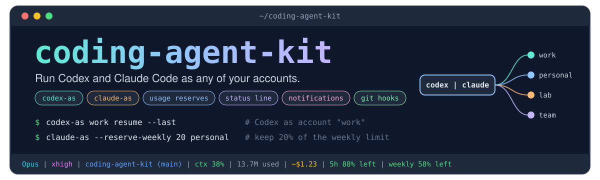
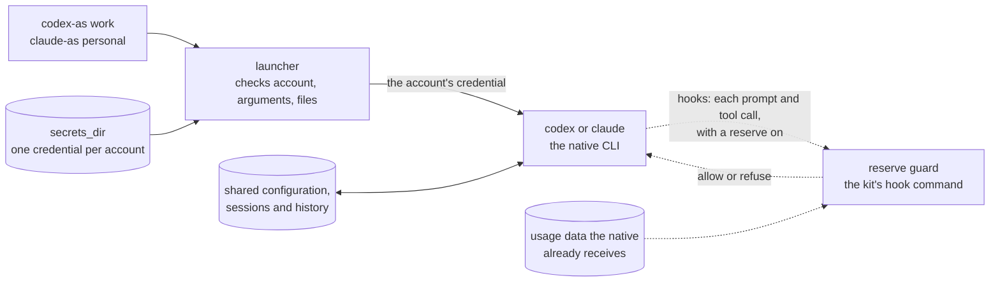

<div align="center">



**Run Codex and Claude Code as any of your accounts, keep part of each account's limits in reserve,**<br>
**and give Claude Code a status line, notifications and a Git hook guard.**

[](https://github.com/FridrichMethod/coding-agent-kit/actions/workflows/ci.yml)
[](https://github.com/FridrichMethod/coding-agent-kit/tags)
[](LICENSE)
[](docs/install.md#requirements)
[](docs/install.md#requirements)

[Highlights](#highlights) | [How it works](#how-it-works) | [Quick start](#quick-start) | [Commands](#commands) | [Documentation](#documentation) | [Changelog](CHANGELOG.md)

</div>

`codex-as NAME` and `claude-as NAME` run the native Codex or Claude Code CLI
as a named account: its private stored credentials, your shared configuration
and history. The kit installs on top of an existing `codex` or `claude` and
never installs, updates or replaces either.

## Highlights

<table>
<tr>
<td width="33%" valign="top"><h4>One CLI, many accounts</h4>
Each account keeps its own credentials in <code>secrets_dir</code>. Codex accounts share configuration, sessions, history and SQLite state, so a session resumes under another account; Claude accounts inherit your existing configuration.</td>
<td width="33%" valign="top"><h4>The native CLI does the work</h4>
Arguments go to the real <code>codex</code> or <code>claude</code>, and Codex's own token refresh writes through to the account's credentials. The kit implements no OAuth. It refuses what would change, revoke or bypass the account's login or split the shared state; with a reserve on, it also refuses launches the guard cannot watch, such as <code>claude-as NAME -p</code>.</td>
<td width="33%" valign="top"><h4>Usage reserves</h4>
<code>--reserve-weekly 20</code> keeps 20% of the weekly limit unused. The natives' own hooks refuse new prompts and tool calls at the reserve, and allow again once the window resets.</td>
</tr>
<tr>
<td width="33%" valign="top"><h4>Accounts at a glance</h4>
<code>--info NAME</code> prints what the kit last saw of an account, its email and plan or its label, and its usage, offline and without opening a credential; zsh completion shows each account's email or label.</td>
<td width="33%" valign="top"><h4>Claude Code helpers</h4>
A status line with model, effort, branch, context, session tokens, cost and limits left; terminal notifications; a check that blocks the usual Git hook bypasses.</td>
<td width="33%" valign="top"><h4>Runs on what you have</h4>
The launchers need POSIX <code>sh</code> or Bash and the Python 3.11 standard library, the helpers Node.js 22: no pip package, virtual environment, compiler or background process.</td>
</tr>
</table>

## How it works



- **Accounts.** `secrets_dir` holds one credential per account; the
  [account layout](docs/account-launchers.md#codex-account-layout) shows what
  Codex accounts share.
- **Reserve guard.** With a reserve on, the native gets the guard's hooks for
  that one launch; the kit writes nothing to the native's configuration (Codex
  itself records your trust of the hooks). It is a soft guard, not a hard
  limit: a streaming reply finishes, and each agent running in parallel at the
  reserve finishes its reply and can make one more request to report the
  refusal. Launch forms it cannot cover are refused; with both windows off, as
  by default, a launch is unchanged
  ([usage reserves](docs/account-launchers.md#usage-reserves)).

## Requirements

| | Needs |
| --- | --- |
| System | Linux or macOS; WSL counts as Linux. Native Windows is not supported. |
| Runtime | Python 3.11 or newer, standard library only; Bash 3.2 or newer for `codex-as`, POSIX `sh` for `claude-as` and `install.sh`; Git and `tar` for the managed install |
| `codex-as` | Codex CLI 0.161.0 or newer, with or without usage reserves; no upper limit |
| `claude-as` | Claude Code; enrolment captures the token automatically with 2.1.296 and asks you to paste it with other versions; usage reserves need 2.1.296 or newer; no upper limit |
| Helpers | Node.js 22 or newer; Git is optional for the status line. Usage reserves need no Node. |
| Optional | bash-completion or zsh for account-name completion |

[Installation requirements](docs/install.md#requirements) has the details, also on removing a 0.6 `install.ps1` install from Windows.

## Quick start

```sh
# Install: a managed install that follows the newest patch release of the 0.9 channel;
# it links the launchers into ~/.local/bin, which must be on PATH
curl -fsSL https://raw.githubusercontent.com/FridrichMethod/coding-agent-kit/main/install.sh | sh -s -- --channel 0.9

# Add and run accounts: a new name asks [y/N], logs in natively, saves the credentials and continues
codex-as work
claude-as personal

# Keep 10% of the 5-hour and 40% of the weekly limit unused for this launch
codex-as --reserve-5h 10 --reserve-weekly 40 work

# Update to a newer patch, which never changes a public interface, or remove (--purge: also the managed root)
"${XDG_DATA_HOME:-$HOME/.local/share}/coding-agent-kit/current/install.sh" --update
"${XDG_DATA_HOME:-$HOME/.local/share}/coding-agent-kit/current/install.sh" --uninstall
```

- **Codex enrolment** uses device login, which must be enabled in the
  account's Security settings or by the workspace admin
  ([adding accounts](docs/account-launchers.md#daily-use-and-adding-accounts)).
- **A launch with a reserve** prints its policy on stderr before the native
  starts:

  ```text
  codex-as: usage reserves for work: five-hour 10% (--reserve-5h), weekly 40% (--reserve-weekly); hooks refuse new prompts and tool calls at a reserve.
  ```

- **Codex trust.** The first guarded interactive Codex launch on a host asks
  once, in Codex's "Hooks need review", to trust the guard's hooks: choose
  "Trust all and continue".
- **A checkout install** is `./install.sh` run in a clone.
- **`--prefix DIR`** links either install into `DIR/bin`. When an install
  places links, it prints the zsh `fpath` line, the helper commands for Claude
  Code's `settings.json` and, when `DIR/bin` is not on `PATH`, a
  `PATH: add DIR/bin` line ([installation](docs/install.md)).

## Commands

```sh
codex-as work resume --last
codex-as work exec --json "Check the tests"
claude-as personal -p "Check the tests"
claude-as --label personal "me@example.com"
```

| Command | What it does |
| --- | --- |
| `codex-as NAME [codex arguments...]` | Codex as account NAME |
| `claude-as NAME [claude arguments...]` | Claude Code as account NAME |
| `--reserve-5h V`, `--reserve-weekly V` | before NAME: keep V percent of the 5-hour or weekly limit unused for this launch (V from 0 through 100, or `off`) |
| `-l`, `--list` | the account names, what completion offers |
| `--labels` | `NAME<TAB>LABEL` lines: the email for Codex, the label for Claude |
| `-i NAME`, `--info NAME` | the last-seen details of one account, offline: email, plan and usage for Codex, label and usage for Claude |
| `claude-as --label NAME [LABEL]` | sets a Claude label, asks for it, or clears it with an empty one |
| `--show-config` | the configuration in effect |
| `-h`, `--help` | the help |
| `-V`, `-v`, `--version` | the kit's release and install form, such as `coding-agent-kit 0.9.0 (managed v0.9.0, channel 0.9)`; `NAME --version` prints the native CLI's |

Own options count only as the first argument, by exact match; native options
go after NAME, and any other dash word before it is refused with a hint
([own options](docs/account-launchers.md#own-options): aliases, exit codes).

## Configuration

One optional TOML file (`CODING_AGENT_KIT_CONFIG`, otherwise
`${XDG_CONFIG_HOME:-~/.config}/coding-agent-kit/config.toml`) moves paths,
names executables and sets usage reserves globally or per account
(`[usage_reserve]`). Without it the launchers use the defaults:

```toml
codex = "codex"            # executable: a name looked up on PATH, or an absolute or ~/ path
claude = "claude"
codex_home = "~/.codex"    # accounts live in codex_home/accounts
secrets_dir = "~/.secrets"
```

Choose `codex_home` and `secrets_dir` before the first enrolment
([configuration](docs/configuration.md)).

## Claude Code helpers

| Helper | What it does |
| --- | --- |
| Status line | model, effort, project and Git branch, context usage, session tokens, estimated cost, and the 5-hour and weekly limits left |
| Notifications | `permission_prompt` and `idle_prompt` events as terminal notifications, with only the project name and a fixed status |
| Git hook checks | a `PreToolUse` check that blocks the usual `--no-verify`, commit `-n` and `-c core.hooksPath=...` forms |

```text
Opus | xhigh | coding-agent-kit (main) | ctx 38% | 13.7M used | ~$1.23 | 5h 88% left | weekly 58% left
```

[Claude Code helpers](docs/helpers.md) covers each helper, its `settings.json`
wiring and the colour of the launchers and the status line.

## Documentation

| Guide | What it covers |
| --- | --- |
| [Installation](docs/install.md) | Requirements, the managed install, a checkout install, linking or copying the files |
| [Account launchers](docs/account-launchers.md) | Adding accounts, own options, usage reserves, account layout, safety boundaries, metadata, completion and manual repair |
| [codex-as](docs/codex-as.md) | Codex argument rules, daemon takeover, version compatibility, the Codex details of usage reserves and the differences from native Codex |
| [Configuration](docs/configuration.md) | The configuration file: location, keys, `[usage_reserve]`, permissions, messages and moving `codex_home` |
| [Claude Code helpers](docs/helpers.md) | Status line, session tokens, notifications, Git hook checks, `settings.json` wiring, and the colour of the launchers and the status line |
| [Development](docs/development.md) | Tests, CI and versioning |

The [documentation index](docs/README.md) lists every guide, [CHANGELOG.md](CHANGELOG.md) every release.

## Contributing

Develop in your own clone; `./tests/run.sh` and `pre-commit run --all-files`
must pass. [Development](docs/development.md) describes the suites and CI,
[AGENTS.md](AGENTS.md) the rules every change keeps.

## License

[MIT](LICENSE) - see the file for the full text.
